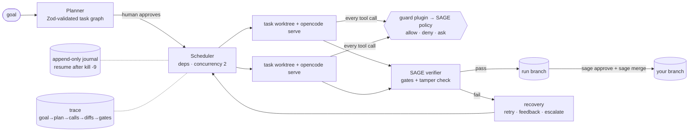

# SAGE

**SAGE is a CLI-first, model-agnostic control plane for autonomous software development, built on
top of [OpenCode](https://github.com/SparshSunilNaik/opencode).** You give it a goal. It plans a
task graph, runs each task in its own git worktree with its own OpenCode process, checks every tool
call against a policy, verifies the result with your own test/typecheck/lint gates (the model never
grades itself), keeps a crash-safe journal of everything, and touches your branch only after you
approve.

OpenCode does the agent work: providers, the tool loop, LSP, MCP and sessions. SAGE adds what a
single coding session lacks: a durable lifecycle, isolation, policy, independent verification,
budgets, human approval gates and an auditable trace. The background research and gap analysis are
in [research.md](research.md); [docs/REPORT_NOTES.md](docs/REPORT_NOTES.md) maps each gap to code
and evidence.



More detail: [docs/ARCHITECTURE.md](docs/ARCHITECTURE.md) ·
[docs/THREAT_MODEL.md](docs/THREAT_MODEL.md) · [ADRs](docs/adr/) ·
[docs/EVALUATION.md](docs/EVALUATION.md) · [PROGRESS.md](PROGRESS.md)

## What works

- **Durable lifecycle.** Run and task state machines over an append-only SQLite event log. Every
  transition is journaled before its side effect. Kill the orchestrator at any point and
  `sage resume` continues without repeating completed steps (tested at 7 kill points).
- **Planning.** The goal becomes a dependency graph with acceptance criteria, expected files and
  explicitly allowed test files. Invalid plans are rejected with the validator's errors and
  re-planned.
- **Execution.** Each task gets its own worktree and branch, its own `opencode serve` process, and
  a fresh session seeded only with its spec and dependency summaries. Tasks run concurrently
  (default 2) in dependency order.
- **Policy.** Every tool call goes through the guard plugin to SAGE, which enforces a path jail,
  read-only tests/CI, a command allow/deny list, network off by default, no secret env access, and
  "ask" prompts to you. Every decision is journaled.
- **Verification.** SAGE runs your gates itself. A task passes only on green gates and no
  unauthorised edits to protected files.
- **Recovery.** Failures are classified (`provider_transient`, `tool_error`, `gate_failed`,
  `policy_denied`, `budget_exhausted`, `conflict`, `unknown`) and handled with backoff, feedback
  retries or escalation to you.
- **Budgets.** USD and token limits per task and per run, enforced after every model call.
- **Oversight.** Plan and merge approvals. Your branch is updated only by `sage merge`
  (fast-forward) after `sage approve`. An agent can never approve or merge its own work.
- **Traceability.** `sage trace` shows goal → plan → task → model calls (model, tokens, cost) → tool
  calls with policy decisions → diffs → gates → approvals. SAGE commits carry `Sage-Run`,
  `Sage-Task` and `Sage-Step` trailers and use your configured git identity.

## Quickstart (Windows-friendly; also works on Linux/macOS)

Prerequisites: **git** and **Bun ≥ 1.4** (`npm i -g bun`, or `powershell -c "irm bun.sh/install.ps1 | iex"`).
For real-model runs you also need **OpenCode 2.x**. SAGE was tested with Bun 1.4.4, git 2.55 and
OpenCode 2.3.0 (and 2.0.29) on Windows 11, and its CI runs on Ubuntu and Windows.
No Docker, WSL or VM needed. The commands below work unchanged in Git Bash, PowerShell, and
macOS/Linux shells.

```bash
git clone --recurse-submodules https://github.com/SparshSunilNaik/sage.git
```

```bash
cd sage
```

```bash
bun install
```

```bash
bun test
```

The test suite makes **zero** model calls; it uses a deterministic fake engine.

```bash
bun run sage doctor
```

`doctor` checks Bun, git and your git identity, the OpenCode binary against the fork's version,
and which OpenCode sign-ins or provider keys exist (names only, never values). It also reports disk
usage. Lines marked `WARN` about OpenCode or provider keys are expected until you set up a real
model, and they do not block the fake-engine demo. The submodule (`engine/opencode`) is only used
to read the engine version and the plugin API, so a clone without `--recurse-submodules` still
works, but `doctor` will report the fork as missing.

### Try it without a model (fake engine, free)

```bash
bun run demo
```

This creates `.cache/demo-repo` and prints the commands to run next, for example:

```bash
bun run sage -C .cache/demo-repo run "add multiply and subtract to src/math.ts" --yes
```

```bash
bun run sage -C .cache/demo-repo trace latest
```

### Use it on your own repo with a real model

1. Install OpenCode 2.x (the fork is at 2.3.0): `npm i -g @opencode/cli@2.3.0`. Then sign in with
   `opencode auth login`, or export a provider key such as `ANTHROPIC_API_KEY` or `OPENAI_API_KEY`.
   Anthropic models are supported with an API key only, not with a Claude Pro/Max subscription.
2. In your repo (the commands below use the current directory as the target repo), run:

```bash
bun path/to/sage/packages/cli/src/bin.ts init
```

3. Edit `sage.config.jsonc`:
   - set `engine.model`, for example `"openai/gpt-6.1-terra"` or `"anthropic/<model>"`;
   - set your gates;
   - list any environment keys in `engine.opencode.passEnv`, or set `"isolateState": false` to use
     OpenCode's stored sign-ins.
4. Check the setup:

```bash
bun path/to/sage/packages/cli/src/bin.ts doctor
```

```bash
bun path/to/sage/packages/cli/src/bin.ts run "your goal"
```

On PowerShell the commands are identical. Use `;` instead of `&&` if you chain them.

## Command reference

| Command | What it does |
|---|---|
| `sage init [--fake <scenario>] [--force]` | Write `sage.config.jsonc` and exclude `.sage/` from git |
| `sage run "<goal>" [--yes] [--concurrency <n>]` | Create a run, plan it, ask for plan approval (or take `--yes`), execute, then stop at merge approval |
| `sage plan "<goal>"` | Plan only; approve later |
| `sage status [run] [--json]` | List runs, or show one run's tasks, usage and pending approvals |
| `sage approve <run> [--request <id>] [--reason <text>]` | Approve the pending plan or merge, or a single policy "ask" request |
| `sage reject <run> [--request <id>] [--reason <text>]` | Reject the run (it becomes ABORTED), or reject a single request |
| `sage resume <run> [--yes] [--retry-escalated]` | Continue from the journal after a crash or an approval, or retry escalated tasks |
| `sage abort <run>` | Abort a run: pending approvals are rejected and a running orchestrator stops at its next checkpoint |
| `sage trace <run> [--json]` | Print the causal trace tree, with totals and approvals |
| `sage diff <run> [--task <id>] [--stat]` | Show the run's or a task's changes |
| `sage merge <run>` | Fast-forward your target branch to the approved run branch |
| `sage doctor` | Check Bun, git and your git identity, the config, the OpenCode version against the fork, OpenCode sign-ins and provider keys (names only, never values) and disk usage |
| `sage gc [--all] [--branches] [--dry-run]` | Remove worktrees of finished runs, kill engine processes they left behind, and optionally delete branches |
| `sage eval [--live] [--out <file>] [--max-usd <n>]` | Run the evaluation suites and write `docs/EVALUATION.md` |

`<run>` accepts a full id, a unique prefix, or `latest`. `-C <path>` selects the target repo.

Developer scripts:

- `bun run lint` / `bun run lint:fix`: Biome, run through its WASM build.
- `bun run typecheck`
- `bun run disk`: disk accounting.
- `bun run probe [opencode-bin]`: start the real engine and check that the guard plugin loads, with
  no LLM call.
- `SAGE_LIVE=1 bun run scripts/live-smoke.ts --model provider/model`: an opt-in paid smoke test
  with a hard budget.

## Evaluation

`sage eval` runs 7 tasks across 3 tiny TypeScript fixture repos, using hidden acceptance tests that
the agent never sees. It also runs four suites:

- chaos: kill -9 at 7 points, then resume;
- red-team;
- an ImpossibleBench-style task;
- a budget hard stop.

The report in [docs/EVALUATION.md](docs/EVALUATION.md) contains measured numbers only. Fake mode
measures SAGE's machinery, not model skill. For live mode, run
`SAGE_LIVE=1 SAGE_EVAL_MODEL=provider/model sage eval --live --max-usd 3`. The official SWE-bench
harness is out of scope because it needs Docker.

## Limitations

- **Isolation is process- and policy-level, not kernel-level.** There are no containers (a project
  constraint). If an agent writes a program and runs it with an allowed interpreter, that program
  runs with your user's privileges. SAGE contains the risk with a scrubbed environment, the
  verifier's tamper check, the merge gate and the trace, but it cannot prevent it. See
  [docs/THREAT_MODEL.md](docs/THREAT_MODEL.md).
- "Network off" applies at the tool and command level. There is no firewall.
- `sage merge` only fast-forwards. If your target branch moved during the run, merge the run branch
  yourself.
- The shell-command analyser is conservative, not a full shell parser. Anything it cannot classify
  is treated as "ask" or "deny".
- Live evaluation numbers, a bare-OpenCode baseline, SWE-bench and ImpossibleBench with real models
  have not been measured yet. See [docs/EVALUATION.md](docs/EVALUATION.md).
- OpenCode V2 keeps credentials in its own database. With the default per-task isolated state, use
  provider keys through `passEnv`, or set `isolateState: false`.
- Single machine, single user. There is no daemon: the CLI process is the orchestrator, and
  `sage resume` restarts it.

## Repository layout

```text
packages/core             state machines, plan/config schemas, event-sourced journal, EngineAdapter
packages/orchestrator     scheduler, lifecycle, guard endpoint, recovery, budgets, approvals/merge
packages/policy           tool-call rule engine
packages/workspace        git/worktrees, process-tree kill, env scrubbing, disk accounting
packages/planner          prompts, plan extraction + validation, re-planning
packages/verify           gates, output parsers, tamper check
packages/trace            spans (OTel GenAI names), redaction, tree renderer
packages/engine-opencode  the OpenCode 2.x adapter (the only OpenCode-aware code)
packages/guard-plugin     the OpenCode plugin (opencode/ is the entry directory OpenCode loads)
packages/testkit          fake engine, fixture repos, scripted scenarios (red team, impossible, …)
packages/cli              the `sage` command
evals/                    `sage eval` suites and report generator
engine/opencode           OpenCode fork (git submodule; no patches needed so far)
docs/                     architecture, threat model, ADRs, evaluation, report notes, evidence
```
