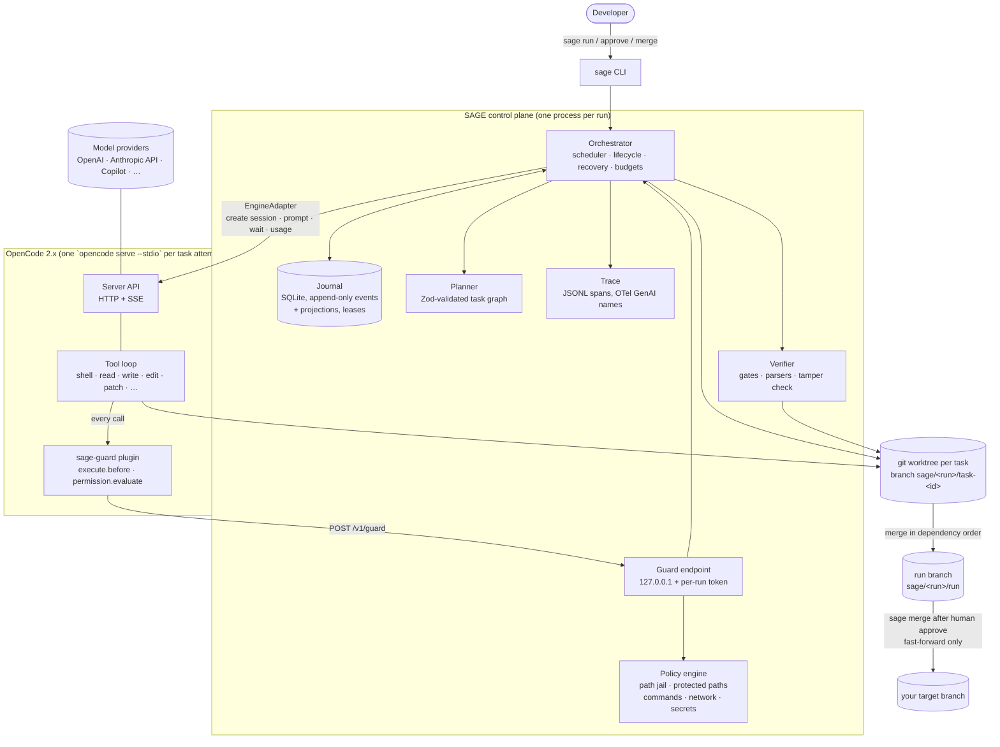
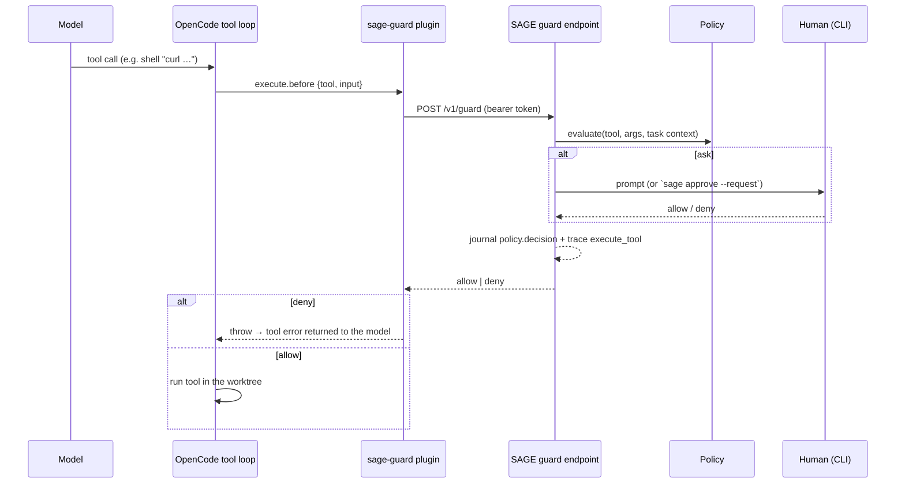

# SAGE — Architecture

SAGE is a **control plane above OpenCode**. OpenCode is the execution engine (providers, the tool
loop, LSP, MCP, sessions). SAGE owns everything around a coding session: the durable task
lifecycle, planning into a task graph, scheduling, per-task workspaces, a policy check on every tool
call, independent verification, budgets, human approval gates and an auditable trace.

## Lifecycle

**Run states:** `CREATED → PLANNING → AWAITING_PLAN_APPROVAL → EXECUTING → AWAITING_MERGE_APPROVAL → MERGED`,
with `FAILED` and `ABORTED` exits (`packages/core/src/states.ts`).

**Task states:** `PENDING → READY → RUNNING → VERIFYING → PASSED`, with `RETRYING`, `ESCALATED`,
`FAILED`. A task can only reach `PASSED` from `VERIFYING`, and `PASSED` means "gates green and
merged into the run branch".

A run, step by step (`packages/orchestrator/src/orchestrator.ts`):

1. `createRun` journals `run.created` (goal, base commit, target branch, run branch).
2. `setup` step: create the run branch from the base commit and an integration worktree.
3. `plan` step: a planner session (read-only policy) returns JSON; it is parsed and validated with
   Zod plus graph checks (unique ids, known deps, acyclic, safe paths). Invalid plans are fed back
   and retried (`retry.maxPlanAttempts`).
4. Plan approval: interactive prompt, `--yes`, or later `sage approve`.
5. Scheduler: promotes `PENDING` tasks whose dependencies `PASSED` to `READY`, runs up to
   `concurrency` (default 2) tasks at once.
6. Per attempt: `workspace:<n>` (worktree reset to the current run-branch tip, so dependants see
   their dependencies' work) → `agent:<n>` (fresh engine process + session seeded only with the task
   spec, plan summary, dependency summaries and retry feedback; commit with `Sage-Run/Task/Step`
   trailers) → `verify:<n>` (gates + tamper check) → `merge:<n>` (serialised `--no-ff` merge into
   the run branch).
7. Failures are classified and handled by `decideRecovery` (ADR 0006).
8. All tasks passed → `AWAITING_MERGE_APPROVAL` with a pending merge approval. `sage approve` +
   `sage merge` fast-forward the target branch.

## Guard path (one tool call)

## Data

- `.sage/sage.db`: `events` (append-only) + projections `runs`, `tasks`, `steps`, `approvals`, and
  the operational `leases` table.
- `.sage/runs/<run>/trace.jsonl`: spans.
- `.sage/wt/<run>/…`: worktrees (removed by `sage gc`).
- `.sage/engine/<run>/<task>-<attempt>/`: per-attempt OpenCode state (DB, logs).

`.sage/` is added to `.git/info/exclude` of the target repo.

## Engine boundary

`EngineAdapter` (`packages/core/src/engine.ts`) has two implementations: `OpencodeEngine`
(`packages/engine-opencode`) and `FakeEngine` (`packages/testkit`). The fake engine sends every
scripted tool call through the same guard HTTP endpoint the real plugin uses, so the whole policy
path is covered by the default (zero-cost) test suite.
